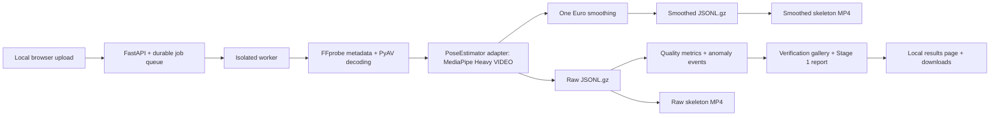

# Linko Gym Coach

A local foundation for extracting human-body pose from ordinary workout videos.
The eventual pipeline is video → pose → biomechanical measurements → selected
keyframes → reasoning → form feedback. **Only Stage 1 is implemented.** There is
no exercise recognition, repetition counting, exercise scoring, AI reasoning, or
coaching in this repository.

Stage 1 produces raw and smoothed landmarks, tracking-quality measurements,
two skeleton-overlay videos, and a verification gallery. Tracking confidence
does not establish anatomical accuracy: visual review is required before
deriving biomechanics. Acceptance evidence and remaining checks are recorded in
[the validation report](docs/validation-report.md).



## Install

Tested on Linux with Python 3.12. Linux/macOS are the intended local platforms;
the supervisor uses POSIX process groups and file locking. Install FFmpeg and
the system OpenCV runtime libraries. On Debian/Ubuntu:

```bash
sudo apt-get update
sudo apt-get install ffmpeg libgl1 libglib2.0-0
```

With [uv](https://docs.astral.sh/uv/getting-started/installation/):

```bash
uv python install 3.12
uv sync --locked
uv run python -m scripts.download_model
```

Without uv, use Python 3.12 and install this project's declared dependencies:

```bash
python3.12 -m venv .venv
. .venv/bin/activate
python -m pip install .
python -m scripts.download_model
```

The explicit setup command downloads Google's versioned Heavy float16 model.
Processing never downloads a model automatically and never sends video, frames,
landmarks, or metadata to external services. Packages/model setup require
Internet access; operation afterward is local. No analytics or third-party web
assets are included.

## Run

From the repository root:

```bash
uv run python -m app.serve
```

Open **http://127.0.0.1:8000**. Select video → Upload & process. The page redirects
to a persistent job URL, shows stage/frame progress, and displays results
automatically. Use one server process and one Uvicorn worker per data directory.
Keep the server running until processing finishes. The worker can take longer
than the recording's duration. Interrupted jobs retain their inputs and logs;
upload again to retry. Queued jobs survive restarts.

To also reach it from your phone on the same Tailscale network:

```bash
uv run python -m app.serve --tailscale
```

This discovers the VM's current Tailscale IPv4 address on every start and binds
only that address plus loopback. It also adds the exact Tailscale IP to the Host
allowlist; same-origin upload checks remain enabled. No wildcard listener,
public interface, router port forwarding, or Tailscale Funnel is used. Open
`http://<tailscale-ip>:8000` while your phone is connected to the same tailnet.

On this VM, startup is persistent through `linko-gym-coach.service`, enabled for
boot and configured to restart on failure. The unit is kept in `deploy/`:

```bash
sudo install -m 644 deploy/linko-gym-coach.service /etc/systemd/system/
sudo systemctl daemon-reload
sudo systemctl enable --now linko-gym-coach.service
sudo systemctl restart linko-gym-coach.service
```

Stop a manually launched server before starting the service. Adjust the unit's
user/group/paths on another machine. Check status/logs with `systemctl status
linko-gym-coach` and `journalctl -u linko-gym-coach`. If Tailscale is unavailable,
the Tailscale startup fails and retries without falling back to a public address.
The VM firewall already accepts `tailscale0`; on a machine with UFW blocking it,
allow only `sudo ufw allow in on tailscale0 to any port 8000 proto tcp`.

This is a **single-user application without application authentication**.
Private Tailscale access relies on tailnet membership/access rules. Public or
multi-user hosting needs a separate authentication and deployment design.

## Supported inputs and outputs

- MP4 and MOV containers where the installed FFmpeg/PyAV decoders support the codec.
- 30/60 FPS, landscape/portrait, and 0/90/180/270° phone display rotation.
- Every decodable frame is tracked, without frame subsampling or a duration cap.
- Presentation timestamps support variable frame intervals. Inputs with broken
  non-monotonic timestamps must be re-exported.
- Default upload limit: 4 GiB; configurable. Long videos are streamed through
  disk-backed storage; all frames and all pose records are never held in memory.
- Browser-oriented H.264 MP4 with faststart, original display resolution and
  frame timing. Overlays are silent; audio stays in the original file.
- Gzip-compressed JSON Lines for raw/smoothed poses; JSON for schema and report;
  SQLite for per-frame metrics; JPEG for full-resolution verification images.

The original upload is retained byte-for-byte. Decoded frames are only modified
where skeleton/HUD drawing occurs; H.264 overlay compression is lossy, so output
pixels outside the drawing cannot be byte-identical to the source. No crop,
resize, replacement background, or color filter is applied. Rare odd dimensions
use yuv444p to preserve the image size, with reduced phone/browser compatibility.

## Pose model and smoothing

[MediaPipe Pose Landmarker](https://ai.google.dev/edge/mediapipe/solutions/vision/pose_landmarker/python),
package **0.10.32**, **Heavy float16 v1**, CPU, **VIDEO** mode, maximum 2 poses,
detection/presence/tracking thresholds 0.5, no segmentation masks. Each detected
pose supplies 33 normalized and world landmarks with visibility and presence.
All returned values are retained, including low confidence and out-of-frame
coordinates. The adapter records model SHA-256 and exact settings per job.

A timestamp-aware One Euro filter separately smooths normalized/world X/Y/Z,
leaving confidences intact. Default minimum cutoff 3 Hz, beta 0.4, derivative
cutoff 1 Hz. Higher velocity raises the cutoff to reduce motion lag. Gaps,
low-confidence landmarks, large jumps, or multi-person ambiguity reset/bypass
the filter. Missing landmarks are never invented. Compare raw/smoothed overlays
using the results-page selector. See [the algorithm and quality policy](docs/stage-1-pose-tracking.md).

## Data and privacy

```text
data/jobs/<uuid>/
  job.json, video.json, diagnostic.log, worker.log
  input/original.mp4 (or .mov)
  tracking/raw.jsonl.gz, smoothed.jsonl.gz, schema.json
  tracking/quality.json, events.jsonl.gz, metrics.sqlite3
  output/pose-overlay.mp4, pose-overlay-raw.mp4
  keyframes/gallery.json, frame-XXXXXX-{original,raw,smoothed}.jpg
```

`data/`, `videos/`, `models/`, local environments, logs, and video extensions are excluded
from Git. Never add private footage or private screenshot exports to `docs/`.
Only documented openly licensed demonstration screenshots belong there.
New application files use private permissions. Privacy is local storage, not
encryption; protect the machine and backups as appropriate.

Automatic cleanup is **disabled by default**, including during development.
Set `LINKO_RETENTION_DAYS` to opt in; terminal jobs older than that many days
are deleted hourly. Active/queued jobs are protected. Preview explicitly:

```bash
LINKO_RETENTION_DAYS=7 uv run python -m scripts.cleanup
LINKO_RETENTION_DAYS=7 uv run python -m scripts.cleanup --apply
```

## Configuration

Environment variables (no `.env` auto-loading):

| Variable | Default | Purpose |
| --- | --- | --- |
| `LINKO_DATA_DIR` | `<repo>/data` | Private job root; use an absolute path |
| `LINKO_MODEL_PATH` | `<repo>/models/pose_landmarker_heavy.task` | Local model bundle |
| `LINKO_MAX_UPLOAD_BYTES` | `4294967296` | Upload-size limit |
| `LINKO_MIN_FREE_BYTES` | `536870912` | Disk-space reserve checked during upload/processing |
| `LINKO_RETENTION_DAYS` | `0` | Disable cleanup; positive values enable deletion |
| `LINKO_WORKER_STALL_SECONDS` | `300` | Stop workers that cease reporting progress |
| `LINKO_MIN_CUTOFF` | `3.0` | One Euro minimum cutoff in Hz |
| `LINKO_BETA` | `0.4` | Velocity-dependent cutoff multiplier |
| `LINKO_DERIVATIVE_CUTOFF` | `1.0` | Velocity-filter cutoff in Hz |
| `LINKO_RESET_GAP_SECONDS` | `0.2` | Filter reset after a timestamp gap |
| `LINKO_CONFIDENCE_THRESHOLD` | `0.5` | Rendering/quality threshold; raw values still retained |
| `LINKO_JUMP_SPEED` | `4.0` | Normalized XY units/s anomaly threshold |
| `LINKO_DEPTH_SPEED` | `4.0` | Normalized Z units/s anomaly threshold |

## Tests and validation

```bash
uv run pytest -q
uv run ruff check app scripts tests
uv run ruff format --check app scripts tests
```

The integration test uses the actual downloaded model and local codecs; it is
skipped if model setup has not run. Tests with a fake pose adapter verify
pipeline mechanics independently of model accuracy. For public demonstration
fixtures (Internet access is used only to download them):

```bash
uv run python -m scripts.validation_samples
uv run python -m scripts.validation_variations
uv run playwright install chromium
uv run python -m scripts.browser_smoke --video data/validation-sources/squat.mp4
```

Follow the [repeatable manual validation procedure](docs/stage-1-pose-tracking.md#manual-validation)
and record evidence. The development [validation report](docs/validation-report.md)
distinguishes automated transport/processing tests, public footage inspection,
and outstanding real-world acceptance. **Do not proceed to Stage 2 based solely
on a High label or a successful run.**

## Current limitations

Single-camera world/depth estimates are inferred, not calibrated biomechanics.
Visibility can be confident and anatomically wrong. Occlusion/cropping/depth/jump
flags are heuristics. MediaPipe can miss additional people; result ordering is
not a subject identity. Fast movement still needs visual lag checks. No gap
interpolation, motion correction, or exercise interpretation is performed.
Arbitrary rotation, non-square pixels, unsupported codecs, corrupt streams,
and extremely large dimensions require re-export. No job resumption mid-video,
Windows supervisor, or remote deployment is included.

See [architecture](docs/architecture.md), [Stage 1 specification and validation](docs/stage-1-pose-tracking.md),
and [screenshots with provenance](docs/screenshots/README.md).
