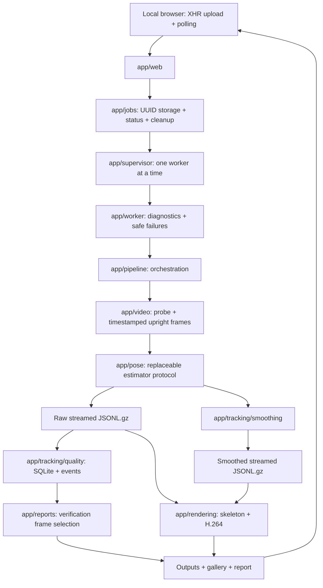

# Stage 1 architecture

The web process streams uploaded bytes to a unique UUID directory and persists
`job.json` atomically. A single supervisor scans queued jobs in creation order.
Each job runs in a separate subprocess: a MediaPipe native crash does not crash
the web server. The supervisor catches unexpected exit/stalled progress and
records a user-facing error; diagnostic details stay in local logs. A POSIX
file lock prevents competing servers from sharing a data directory.

## Module contracts

| Component | Responsibility |
| --- | --- |
| `pose/schema.py` | Estimator protocol, landmark vocabulary, skeleton connections |
| `pose/mediapipe_engine.py` | Only module that imports MediaPipe; returns all poses |
| `video/reader.py` | Inspect metadata, decode RGB frames sequentially, apply display rotation |
| `tracking/storage.py` | Gzip JSON Lines reading/writing without whole-file loading |
| `tracking/smoothing.py` | Independent timestamp-aware filtering, no raw mutation |
| `tracking/quality.py` | Raw confidence/gap/anomaly metrics, disk-backed frame index |
| `rendering/overlay.py` | Pure drawing on a copied decoded frame |
| `rendering/writer.py` | Browser-oriented H.264 MP4 encoding with presentation timestamps |
| `reports/keyframes.py` | Distributed/extreme/anomaly selection and comparison images |
| `pipeline.py` | Stage orchestration, progress, artifacts; accepts alternate estimator factory |
| `web/` | Upload, status, allowlisted file access, plain local browser interface |

The adapter accepts an upright RGB array and monotonically increasing integer
milliseconds; normalized output retains engine values and original order.
Frame records contain actual presentation seconds plus the timestamp passed
to the engine. Sub-millisecond collisions are advanced by 1 ms only for the
engine; original timestamps remain intact and adjustments are counted.

## Long recordings and tradeoffs

Tracking is sequential in VIDEO mode with no subsampling. Raw/smoothed records
are compressed as they are written. Per-frame confidence/motion/anomaly values
are indexed in SQLite. Landmark accumulators are fixed-size; event records are
streamed. Only a bounded sample of interruption intervals is put in the report;
the full event file preserves all intervals and frame anomalies.

Three decode passes are intentional: tracking; overlay encoding; gallery
extraction. This avoids full-resolution frame caches and a massive temporary
uncompressed video. The tradeoff is extra decode work. Two output encoders
make raw/smoothed comparison available, with extra CPU/disk cost. Each pass
reports progress, checks disk reserve, and releases resources on failure.
Final encoding faststart relocation can briefly pause progress; the watchdog
timeout is configurable for slower disks.

One worker makes CPU/disk demands predictable. Job status contains only
aggregates and ≤10 gallery references, not whole tracking arrays. No Redis,
cloud storage, external queue, or external inference service is required.
Per-frame SQLite insertion commits every 100 records; interrupted artifacts
are diagnostics, not completed reports. Incomplete outputs are not offered for
download. There is no mid-video resume because temporal tracker state cannot
be recovered faithfully from the persisted pose records alone.

## Lifecycle and private data

Upload → queued → processing → complete/failed. A server restart keeps queued
jobs and marks incomplete uploads/processing interrupted. All input bytes and
job logs survive ordinary processing failures. The supervisor terminates workers
on orderly shutdown and detects native process exits. Retention applies only
to terminal jobs and is disabled unless explicitly configured. Manual cleanup
defaults to a dry run.

Local UUIDs are identifiers, not authentication. API file access is an explicit
per-job artifact allowlist, including generated gallery paths; paths/logs/config
outside it are never exposed. Cross-origin browser uploads are rejected and
responses disable caching; UI text uses `textContent`. No remote scripts,
telemetry, fonts, or image services are used. Bind to loopback and protect the
local disk. The optional `app.serve --tailscale` launcher binds loopback and the
current private Tailscale IPv4 only, adding that exact IP to the Host allowlist.
The persistent systemd unit discovers the address again on each restart. No
public listener or router forwarding is configured. Decoding/probing only allow
local file/pipe protocols. Public or multi-user hosting
requires a dedicated security/deployment design. On Linux, workers also receive
a parent-death signal so a hard server crash cannot leave an old worker writing
into a job after restart.

## Extension points for later stages

A replacement estimator should implement the adapter protocol and describe its
model/settings in metadata. Coordinate systems must be explicit; different
landmark vocabularies need a schema version rather than silently reusing IDs.
Later measurements/segmentation/reasoning should read versioned tracking files
and produce separate artifacts. Do not mutate raw records or reinterpret
tracking-quality labels as exercise scores. These future components are not
implemented in Stage 1.
